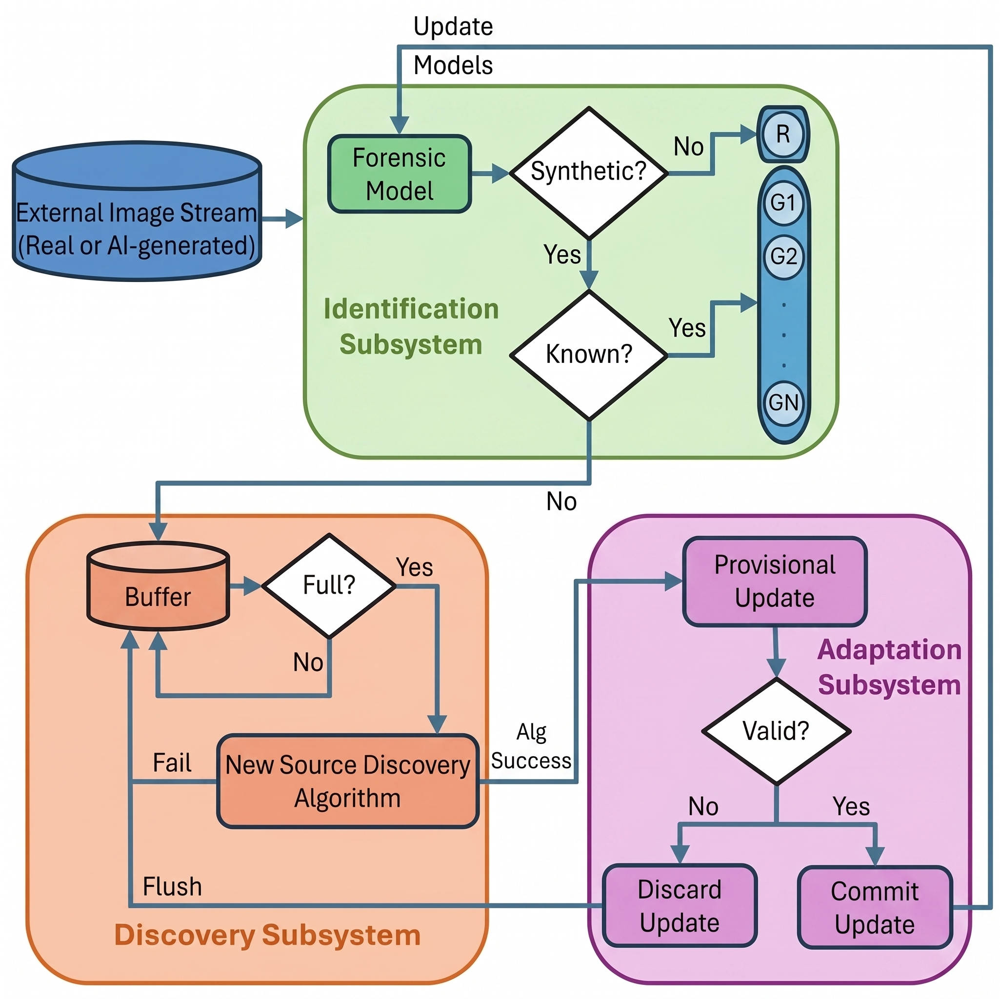

# Autonomous and Self-Adaptive AI-Generated Image Identification Systems (AS-AID)

Official PyTorch implementation of the paper:
**"Autonomous and Self-Adaptive AI-Generated Image Identification Systems"**  
*Accepted to IEEE/CVF Winter Conference on Applications of Computer Vision (WACV), 2027.*

[](https://arefazizpour.github.io/Autonomous-and-Self-Adaptive-AI-Generated-Image-Identification-Systems/)
[](https://wacv2027.thecvf.com/)
[](https://opensource.org/licenses/MIT)

---

## 📌 Overview



Detecting AI-generated images is increasingly challenging as new generative models rapidly emerge. Existing detectors perform well on known sources but often fail to recognize images from unseen ones and cannot adapt without human supervision.

To address these challenges, we propose **AS-AID**, an Autonomous and Self-Adaptive AI-Generated Image Identification framework that autonomously detects AI-generated images and integrates models of novel forensic sources without human intervention. AS-AID unifies three key capabilities:
1. **AI-Generated Image Identification subsystem:** Categorizes an unlabeled image stream into real, known synthetic sources, and unknown synthetic sources using an enhanced forensic embedding space.
2. **New Source Discovery subsystem:** Isolates high-purity clusters representing newly emerging forensic sources among unattributed images.
3. **Autonomous Adaptation and Validation subsystem:** Dynamically expands the embedding space to accommodate novel microstructures and validates each update without human oversight.

---

## 🚀 Getting Started

*(Code release coming soon)*

### Environment Setup
```bash
git clone https://github.com/arefazizpour/Autonomous-and-Self-Adaptive-AI-Generated-Image-Identification-Systems.git
cd Autonomous-and-Self-Adaptive-AI-Generated-Image-Identification-Systems
```

---

## 📖 Citation

If you find this work or codebase useful in your research, please cite:

```bibtex
@inproceedings{azizpour2027autonomous,
  title={Autonomous and Self-Adaptive AI-Generated Image Identification Systems},
  author={Azizpour, Aref and Nguyen, Tai D. and Stamm, Matthew C.},
  booktitle={Proceedings of the IEEE/CVF Winter Conference on Applications of Computer Vision (WACV)},
  year={2027}
}
```

---

## ✉️ Contact
For questions or issues, please open an issue or contact:
* **Aref Azizpour**: `aa4639@drexel.edu`
* **Tai D. Nguyen**: `tdn47@drexel.edu`
* **Matthew C. Stamm**: `mcs382@drexel.edu`
